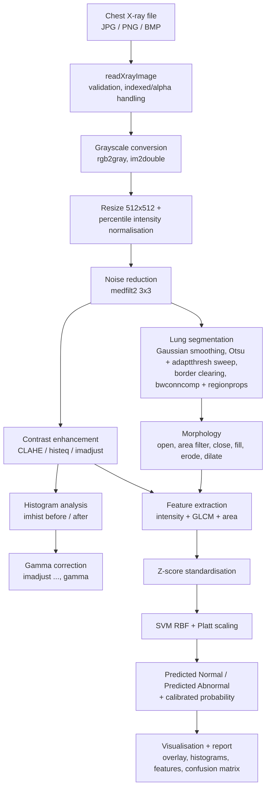

# Chest X-Ray Abnormality Detection using MATLAB

> **Medical disclaimer** — This system is intended for educational and research
> purposes only and does not provide a medical diagnosis. Results should not be
> used for clinical decision-making.

An educational medical-image-processing mini-project. A MATLAB application takes
a real chest X-ray, preprocesses and enhances it, segments the lung fields with
classical image processing, refines the mask with morphology, extracts intensity
and GLCM texture features, and classifies the image as **Predicted Normal** or
**Predicted Abnormal** with a Support Vector Machine (no deep learning).

---

## Contents

1. [Project objective](#1-project-objective)
2. [Features](#2-features)
3. [Technologies used](#3-technologies-used)
4. [Dataset setup](#4-dataset-setup)
5. [Installation / setup](#5-installation--setup)
6. [How to train the model](#6-how-to-train-the-model)
7. [How to run the GUI](#7-how-to-run-the-gui)
8. [Image-processing pipeline](#8-image-processing-pipeline)
9. [Morphological operations](#9-morphological-operations)
10. [Feature extraction](#10-feature-extraction)
11. [SVM classification](#11-svm-classification)
12. [Evaluation metrics and results](#12-evaluation-metrics-and-results)
13. [Limitations](#13-limitations)
14. [Medical disclaimer](#14-medical-disclaimer)
15. [Project structure](#15-project-structure)
16. [Testing](#16-testing)

---

## 1. Project objective

Build a complete, modular MATLAB pipeline that demonstrates the core techniques
of a medical image processing course on real chest radiographs:

* image input & validation, grayscale conversion, noise reduction
* contrast enhancement (imadjust / histeq / CLAHE) and histogram analysis
* adjustable gamma correction
* approximate lung-field segmentation (Otsu + adaptive thresholding +
  connected-component analysis)
* morphological refinement (erosion, dilation, opening, closing, hole filling)
* intensity and GLCM texture feature extraction
* SVM classification with a proper stratified train/test split and honest
  evaluation (accuracy, precision, sensitivity, specificity, F1, confusion matrix)
* an interactive GUI

The output is always phrased as a **model prediction**, never as a diagnosis.

## 2. Features

* **GUI** (`main/ChestXrayApp.m`, App Designer structure) with the buttons
  *Upload X-Ray, Preprocess, Enhance Image, Segment Lung, Apply Morphology,
  Extract Features, Predict, Reset*, an enhancement-method selector, a gamma
  slider + numeric field, and five tabs:
  * **Main View** – Original X-Ray, Enhanced X-Ray, Lung Segmentation, Final
    Processed Image (lung overlay on the X-ray) + result panel
    (`Prediction: NORMAL/ABNORMAL`, `Confidence/Score: XX%`)
  * **Preprocessing & Histograms** – grayscale, denoised, gamma-corrected image,
    histogram before/after enhancement, table comparing the three enhancement methods
  * **Morphology** – mask before/after morphology, pixel counts after each operator
  * **Features** – table of all extracted feature values
  * **Model Evaluation** – confusion matrix and metrics of the trained model
* Permanent on-screen medical disclaimer.
* Training script with automatic dataset discovery (no hard-coded file names),
  feature caching (`features.mat`), stratified split, cross-validated
  hyper-parameters, calibrated probabilities and a full evaluation report.
* `demoPipeline` produces publication-style figures of every step for any image.
* Graceful, readable error messages for: no image selected, invalid format,
  corrupted image, missing dataset, missing model, empty segmentation, feature
  extraction failure, missing toolbox.

## 3. Technologies used

| Component | Used for |
|---|---|
| MATLAB (R2020b or newer recommended) | language/runtime |
| Image Processing Toolbox | `rgb2gray`, `medfilt2`, `imadjust`, `histeq`, `adapthisteq`, `imgaussfilt`, `graythresh`, `imbinarize`, `adaptthresh`, `bwconncomp`, `regionprops`, `imclearborder`, `strel`, `imerode`, `imdilate`, `imopen`, `imclose`, `imfill`, `bwareaopen`, `graycomatrix`, `graycoprops`, `entropy`, `imhist` |
| Statistics and Machine Learning Toolbox | `fitcsvm`, `predict`, `compact` |
| App Designer components | `uifigure`, `uigridlayout`, `uiaxes`, `uibutton`, `uislider`, `uitable`, … |

No deep learning is used. The toolboxes are checked at start-up
(`utils/checkToolboxes.m`) and a clear message is shown if one is missing.

## 4. Dataset setup

The images are **not** bundled with the project (≈1 GB, and redistributed under
the licences of their original sources). The code reads **whatever images are
placed in** `dataset/Normal/` and `dataset/Abnormal/` (JPG, JPEG, PNG, BMP; any
size; RGB or grayscale):

```text
dataset/
    Normal/
        image1.jpg
        image2.png
        ...
    Abnormal/
        image1.jpg
        ...
```

### Option A – reference dataset used for the reported results (recommended)

Two public GitHub repositories of real chest X-rays:

| Repository | Content used |
|---|---|
| [agchung/Actualmed-COVID-chestxray-dataset](https://github.com/agchung/Actualmed-COVID-chestxray-dataset) | "No finding" (Normal) and "COVID-19" (Abnormal) frontal X-rays from Actualmed / Universitat Jaume I. Research use only. |
| [ieee8023/covid-chestxray-dataset](https://github.com/ieee8023/covid-chestxray-dataset) | "No Finding" (Normal) and pneumonia / COVID-19 / SARS / TB / other findings (Abnormal). Per-image licence in its `metadata.csv` (CC BY, CC BY-NC-SA, …). |

`setup/dataset_manifest.csv` lists the exact 270 images used
(**135 Normal / 135 Abnormal, frontal PA/AP views only, one image per patient**
so no patient can appear in both the training and the test set). Steps:

```bash
# 1) clone the two repositories somewhere outside the project
git clone --depth 1 https://github.com/agchung/Actualmed-COVID-chestxray-dataset actualmed
git clone --depth 1 https://github.com/ieee8023/covid-chestxray-dataset ieee
```

```matlab
% 2) in MATLAB, from the project folder
setupProject
prepareDataset('path/to/actualmed', 'path/to/ieee')   % copies 270 images into dataset/
```

`prepareDataset` copies each image to `dataset/<Class>/<source>_<patientId>_<file>`.
The selection rules are documented in `setup/make_manifest.py`.

### Option B – any other labelled chest X-ray dataset

For example the Kaggle *Chest X-Ray Images (Pneumonia)* dataset (Kermany et al.):
copy `NORMAL` images into `dataset/Normal/` and `PNEUMONIA` images into
`dataset/Abnormal/`. Try to keep the classes roughly balanced and avoid several
images of the same patient. Then train as below.

## 5. Installation / setup

1. Install MATLAB with the **Image Processing Toolbox** and the **Statistics and
   Machine Learning Toolbox**.
2. Clone/download this repository.
3. In MATLAB, `cd` into the project folder and run `setupProject` (adds the
   sub-folders to the path using paths relative to the project – nothing is
   hard-coded).
4. Prepare the dataset (section 4).

## 6. How to train the model

```matlab
setupProject
[model, testMetrics] = trainModel();          % uses dataset/, writes features.mat,
                                              % models/trainedModel.mat and results/
trainModel('ForceRecompute', true);           % ignore the features.mat cache
trainModel('DatasetDir', 'D:\my_cxr_data');   % use another dataset folder
```

What happens:

1. Every image in `dataset/Normal` and `dataset/Abnormal` goes through the
   pipeline (resize 512×512 → grayscale → normalisation → median filter →
   CLAHE → lung segmentation → morphology → features). Unreadable images or
   failed segmentations are skipped and listed in `results/failed_images.csv`.
2. Features + labels are stored in **`features.mat`** (a MATLAB `table`
   `featureTable` plus plain `featureMatrix`/`labels`). The file is re-used
   automatically while the image list and configuration are unchanged.
3. Stratified 80/20 train/test split (seed 42).
4. Z-score standardisation with training-set statistics only.
5. RBF SVM; `BoxConstraint` and `KernelScale` chosen by stratified 5-fold
   cross-validation on the training set (balanced accuracy).
6. Platt scaling fitted on out-of-fold CV scores → calibrated P(Abnormal).
7. Final model saved to **`models/trainedModel.mat`**; test-set evaluation
   written to `results/` (`metrics.txt`, `metrics.csv`, `confusion_matrix.png`,
   `test_predictions.csv`, `cv_grid.csv`).

Then create the explanatory sample figures:

```matlab
demoPipeline                          % one Normal + one Abnormal TEST image
demoPipeline('path/to/any_xray.png')  % any image
```

> **The trained model is not committed to the repository.** A model trained in
> MATLAB must be produced by running `trainModel` (feature extraction for the
> 270 images took ≈5 minutes in the Octave test run; most of it is reading the
> large PNG files). See section 12 for the reference
> results obtained when this exact pipeline was executed.

## 7. How to run the GUI

```matlab
startApp            % or: setupProject; ChestXrayApp
```

1. **Upload X-Ray** – choose a JPG/JPEG/PNG/BMP chest X-ray.
2. **Preprocess** – grayscale, resize, normalisation, median filter.
3. Choose an enhancement method → **Enhance Image**; move the **gamma** slider
   (or type a value 0.2–3.0) to explore gamma correction live.
4. **Segment Lung** → **Apply Morphology** → **Extract Features** → **Predict**.
5. **Reset** clears everything.

The result panel shows `Prediction: NORMAL` / `Prediction: ABNORMAL` and
`Confidence/Score: XX%`. The percentage is the **Platt-calibrated probability
of the predicted class**, derived from the trained SVM (see section 11) — it is
only shown when a trained model exists. Without `models/trainedModel.mat` all
processing steps work, and *Predict* explains that the model must be trained
first.

> About `.mlapp`: App Designer's `.mlapp` is a binary format that can only be
> written by the App Designer editor. The GUI is therefore delivered as
> `main/ChestXrayApp.m`, a class with exactly the structure App Designer
> generates (`matlab.apps.AppBase`, `createComponents`, callbacks,
> `startupFcn`). It runs directly and can be extended in the MATLAB editor.

## 8. Image-processing pipeline



Plain-text version:

```text
Chest X-Ray Input
 → Grayscale conversion (rgb2gray)            preprocessing/preprocessImage.m
 → Resize 512x512 + intensity normalisation
 → Noise reduction (median 3x3)
 → Contrast enhancement (CLAHE default)       preprocessing/enhanceImage.m
 → Histogram analysis (before / after)        preprocessing/compareEnhancement.m
 → Gamma correction (GUI slider)              preprocessing/gammaCorrection.m
 → Lung region segmentation                   segmentation/segmentLung.m
 → Morphological processing                   segmentation/morphologicalProcessing.m
 → Feature extraction                         features/extractFeatures.m
 → SVM classification                         machine_learning/trainModel.m, classifyFeatures.m
 → Normal / Abnormal model prediction         machine_learning/predictImage.m
 → Visualisation + analysis report            main/ChestXrayApp.m, main/demoPipeline.m
```

### Preprocessing (`preprocessImage.m`)

* **Grayscale** – RGB images are converted with `rgb2gray`; grayscale, 16-bit,
  indexed and RGBA images are all handled (`readXrayImage`).
* **Resize** – every image becomes 512×512 so features are comparable.
* **Normalisation** – intensities are stretched between the 0.5th and 99.5th
  percentile, which compensates for different exposures between machines.
* **Noise reduction: median filter (`medfilt2`, 3×3)** – radiographs contain
  impulse-like noise (dead/hot detector pixels, quantum mottle, compression
  artefacts). A median filter removes these outliers while **preserving edges**
  (lung borders, ribs, diaphragm). A Gaussian filter would blur those edges
  uniformly and degrade the threshold-based segmentation. The small window keeps
  the fine lung texture needed for the GLCM features.

### Contrast enhancement (`enhanceImage.m`, `compareEnhancement.m`)

| Method | Behaviour on chest X-rays |
|---|---|
| `imadjust` | one global linear stretch – simple, limited gain where contrast is already used |
| `histeq` | global equalisation – maximal global contrast but over-amplifies noise and washes out the mediastinum |
| **CLAHE** (`adapthisteq`, default) | equalises 8×8 tiles separately with a clip limit – reveals vessel/rib/lung-field detail in both dark and bright regions without amplifying noise |

The GUI and `demoPipeline` show the histogram before and after enhancement and a
table with global contrast (std), entropy and mean edge strength of every
method.

### Gamma correction (`gammaCorrection.m`)

`imadjust(img, [], [], gamma)`: γ < 1 brightens dark lung fields, γ > 1
emphasises bright structures (bone, dense opacities). It is interactive in the
GUI. For classification the training setting (γ = 1) is always used so features
stay comparable with the training data.

### Lung segmentation (`segmentLung.m`)

No single threshold works for every X-ray, so the method searches over
several candidates and keeps the most plausible one:

1. Gaussian smoothing (`imgaussfilt`, σ = 2) – thresholding then reacts to the
   large dark lung fields, not to rib/vessel texture.
2. **Global Otsu threshold** (`graythresh` + `imbinarize`) computed on the
   central part of the image (borders, labels and collimation are excluded).
3. **Adaptive threshold** (`adaptthresh`, dark foreground, window = ¼ of the
   image) for 4 sensitivities, each **with and without** the global gate.
4. Air outside the body touches the image border: it is removed with
   `imclearborder` applied to an eroded copy (so lungs only thinly connected to
   the outside air survive), then grown back.
5. **Connected-component analysis** (`bwconncomp`, `regionprops`): only
   components with lung-like area and centroid position are kept – the largest
   on the left and the largest on the right half.
6. Each candidate is scored (two lungs found, total area 8–45 % of the image,
   left/right symmetry); the best one is returned. If nothing plausible is found,
   the mask is empty and the user gets an "Empty segmentation" message instead
   of a guess.

## 9. Morphological operations

`morphologicalProcessing.m`, structuring elements `strel('disk', r, 0)`:

| Step | Operation | Purpose |
|---|---|---|
| 1 | `imopen` (disk 5) | remove small noise and thin spurs leaking along the trachea / costophrenic angles |
| 2 | `bwareaopen` (0.5 % of image) | remove small unwanted isolated objects |
| 3 | `imclose` (disk 12) | connect broken pieces of a lung and smooth concave notches |
| 4 | `imfill(...,'holes')` | fill holes left by vessels, ribs and **bright opacities** – important, otherwise dense abnormal regions would be excluded from the lung ROI |
| 5 | `imerode` (disk 3) | peel a thin boundary layer |
| 6 | `imdilate` (disk 3) | grow it back – erosion followed by dilation smooths the contour |
| 7 | keep 2 largest regions | left and right lung |

The GUI (Morphology tab) and `demoPipeline` (`*_morphology.png`) show the mask
before and after, and every intermediate stage.

## 10. Feature extraction

`extractFeatures.m` computes a 13-element vector **inside the final lung mask**:

| Group | Features | Computed on |
|---|---|---|
| Intensity | Mean, Std, Variance, Min, Max, Entropy, Skewness, Kurtosis | normalised, denoised image |
| Texture (GLCM) | Contrast, Correlation, Energy, Homogeneity | CLAHE-enhanced image; `graycomatrix` with 16 grey levels, distance 1, offsets 0°/45°/90°/135° (averaged), symmetric; pixels outside the lungs are set to NaN so they are ignored |
| Shape | LungAreaRatio | segmented lung area / image area |

`features.mat` stores them as a MATLAB table (`featureTable`, one row per image,
columns = features + `Label` + `File`).

## 11. SVM classification

* Classifier: `fitcsvm`, RBF kernel, inputs z-scored with training statistics.
* Hyper-parameters: grid `BoxConstraint ∈ {0.1, 1, 10, 100}` ×
  `KernelScale ∈ {0.5, 1, 2, 4, 8}·√13`, selected by stratified 5-fold CV
  balanced accuracy on the **training set only**.
* Probability: Platt scaling (`fitPlattScaling.m`) fitted on the out-of-fold
  cross-validation scores, giving P(Abnormal | SVM score). The decision rule is
  P(Abnormal) ≥ 0.5. The GUI's *Confidence/Score* is the calibrated probability
  of the predicted class – derived from the trained model, never invented.
* `predictImage('xray.png')` runs the whole pipeline + classifier for a file.

## 12. Evaluation metrics and results

Positive class = **Abnormal**.

| Metric | Formula | Meaning |
|---|---|---|
| Accuracy | (TP+TN)/N | overall percentage of correct predictions |
| Precision | TP/(TP+FP) | percentage of predicted-abnormal cases that are actually abnormal |
| Recall / Sensitivity | TP/(TP+FN) | ability to correctly identify abnormal cases |
| Specificity | TN/(TN+FP) | ability to correctly identify normal cases |
| F1-score | 2·P·R/(P+R) | balance between precision and recall |
| ROC AUC | rank statistic | probability that an abnormal image scores higher than a normal one |

### Reference results (actually obtained – read the caveats)

The full pipeline was executed end-to-end on the 270 real images of the
reference dataset (section 4). **These runs were performed with GNU Octave 8.4
+ statistics 1.7.0, not MATLAB** (no MATLAB licence was available in the build
environment). Octave lacks a few Image Processing Toolbox functions, which were
replaced by test-only re-implementations (`tests/octave_compat/`, e.g. CLAHE,
`adaptthresh`, GLCM). Octave's random-number stream also differs from MATLAB's,
so the train/test split differs. **When you run `trainModel` in MATLAB your
numbers will differ** – `results/metrics.txt` is then overwritten with the
MATLAB results. No MATLAB `trainedModel.mat` is shipped: **the model still has
to be trained in MATLAB** (one command, section 6).

**Main experiment** – 270 images (135 Normal / 135 Abnormal, one per patient),
stratified 80/20 split → 216 train / 54 test. Selected hyper-parameters:
BoxConstraint = 100, KernelScale = 1.80. Feature extraction succeeded for 270/270
images.

| Metric (Abnormal = positive) | Held-out test set (n = 54) | 5-fold CV on training set (n = 216) |
|---|---|---|
| Accuracy | **74.1 %** | 69.4 % |
| Precision | 72.4 % | 69.8 % |
| Sensitivity / recall | 77.8 % | 68.5 % |
| Specificity | 70.4 % | 70.4 % |
| F1-score | 75.0 % | 69.2 % |
| ROC AUC | 0.798 | 0.729 |

Test confusion matrix (`results/confusion_matrix.png`):

| | Predicted Normal | Predicted Abnormal |
|---|---|---|
| **True Normal** (27) | 19 (TN) | 8 (FP) |
| **True Abnormal** (27) | 6 (FN) | 21 (TP) |

**Source-controlled check (important).** In the reference dataset most Normal
images come from one hospital (Actualmed) while most Abnormal images come from
the literature-based ieee8023 collection, so a classifier can partly learn *which
source* an image comes from instead of the disease. To measure this, the same
code was trained/tested on the Actualmed images only (120 Normal / 51 Abnormal,
same hospital for both classes; `results/source_controlled_actualmed_only/`):

| Metric | Held-out test (n = 34: 24 Normal / 10 Abnormal) |
|---|---|
| Accuracy | 73.5 % (mostly from predicting "Normal") |
| Sensitivity | **20.0 %** (2 / 10) |
| Specificity | 95.8 % (23 / 24) |
| Balanced accuracy | 57.9 % (CV on training set: 58.9 %) |
| ROC AUC | 0.812 (small test set – very uncertain) |

**Interpretation:** hand-crafted global intensity/texture features of an
approximate lung mask carry only a weak signal for COVID-19/pneumonia. Part of
the 74 % on the mixed dataset is very likely due to differences between the two
data sources. With 54 (or 34) test images the uncertainty of every metric is
also large (roughly ±12 percentage points for the accuracy). This is expected for
a classical-features educational project and is reported here as measured.

Sample outputs (`results/sample_output/`, produced by `demoPipeline` on two
**test-set** images): `*_pipeline.png` (original → grayscale → denoised → CLAHE
→ gamma → threshold mask → morphology → overlay), `*_histograms.png` (histograms
and comparison of the enhancement methods), `*_morphology.png` (every
morphological stage) and `*_report.txt` (feature values + prediction). Note that
the Abnormal example (`actualmed_ANON100_...`) is **misclassified** by the model
as *Predicted Normal* (P(Abnormal) = 33.5 %) – one of the 6 false negatives.

All per-image test predictions are in `results/test_predictions.csv`, the
hyper-parameter search in `results/cv_grid.csv`.

## 13. Limitations

* **Not a diagnostic tool.** Educational project; no clinical validation.
* **Weak, partly source-confounded signal** – see the source-controlled check in
  section 12: on single-hospital data the sensitivity was only 20 %.
* **Small dataset** (270 images, 54 test images) → wide confidence intervals;
  the single hold-out split is one random draw.
* **Approximate segmentation.** Classical thresholding under-segments lungs that
  are very dense (large consolidations, effusions) and can miss the lung
  periphery or retro-cardiac regions; it can fail on lateral views, children,
  heavily rotated or inverted (MONOCHROME1) images. Failures are reported, not
  hidden.
* **Global features only** – means/texture over the whole lung lose the location
  of focal lesions; there is no lesion detection or localisation.
* Images are resized to 512×512 without preserving the aspect ratio.
* "Abnormal" mixes many findings (COVID-19, bacterial/viral pneumonia, TB, …);
  only a binary Normal/Abnormal decision is made.
* The GUI (`ChestXrayApp.m`) is written against the documented App Designer API
  and was syntax-checked, but **it could not be executed in the build
  environment** (no MATLAB). All functions it calls were executed and tested.
* Reference numbers were produced with GNU Octave + compatibility shims, not
  MATLAB (see section 12).

## 14. Medical disclaimer

**This system is intended for educational and research purposes only and does
not provide a medical diagnosis. Results should not be used for clinical
decision-making.** The application only ever reports a *model prediction*
("Predicted Normal", "Predicted Abnormal", "candidate abnormality"). It has not
been validated clinically, was trained on a small public research dataset, and
must not be used to make or support decisions about any patient.

## 15. Project structure

```text
MIP_PROJECT/                      (project root)
├── startApp.m                    launch the GUI
├── setupProject.m                add project folders to the MATLAB path
├── main/
│   ├── ChestXrayApp.m            App Designer-style GUI
│   ├── runPipeline.m             all processing steps for one image
│   └── demoPipeline.m            sample-output figures + report
├── preprocessing/
│   ├── preprocessImage.m         grayscale, resize, normalisation, median filter
│   ├── enhanceImage.m            imadjust / histeq / CLAHE
│   ├── compareEnhancement.m      side-by-side comparison + contrast measures
│   └── gammaCorrection.m
├── segmentation/
│   ├── segmentLung.m
│   └── morphologicalProcessing.m
├── features/
│   └── extractFeatures.m
├── machine_learning/
│   ├── trainModel.m              training + evaluation entry point
│   ├── buildFeatureDataset.m     dataset scan + features.mat
│   ├── stratifiedSplit.m, stratifiedKFold.m
│   ├── fitPlattScaling.m         SVM score → probability
│   ├── classifyFeatures.m, predictImage.m, loadTrainedModel.m
│   ├── evaluateModel.m           metrics + confusion matrix
│   ├── plotConfusionMatrix.m
│   └── saveEvaluationReport.m
├── utils/                        getConfig (all parameters), readXrayImage,
│                                 checkToolboxes, createOverlay, isOctaveRuntime
├── setup/                        prepareDataset.m, dataset_manifest.csv, make_manifest.py
├── dataset/Normal, dataset/Abnormal   (images not committed)
├── models/                       trainedModel.mat is created by trainModel
├── features.mat                  created by trainModel
├── results/                      reference evaluation + sample outputs
└── tests/                        runPipelineTests.m, Octave validation + shims
```

All parameters (image size, filter sizes, CLAHE settings, segmentation and
morphology radii, GLCM settings, SVM grid, split, seed) live in
`utils/getConfig.m`.

## 16. Testing

* `tests/runPipelineTests.m` – runs the pipeline on 10 real dataset images and
  checks input variations (RGB, grayscale, uint16, non-square, PNG/BMP/JPG) and
  every error path (no image, missing file, invalid format, corrupted file,
  empty segmentation, missing dataset, missing model, invalid gamma), plus a
  hand-checked metric example.
* `tests/runOctaveValidation.m` – runs `trainModel` + `demoPipeline` in GNU
  Octave (see `tests/octave_compat/README.md`).

Last run (GNU Octave 8.4, `xvfb-run octave --no-gui tests/runOctaveValidation.m`):
feature extraction 270/270 images, training and evaluation as reported in
section 12, `demoPipeline` figures, and **31 / 31 tests passed**.
