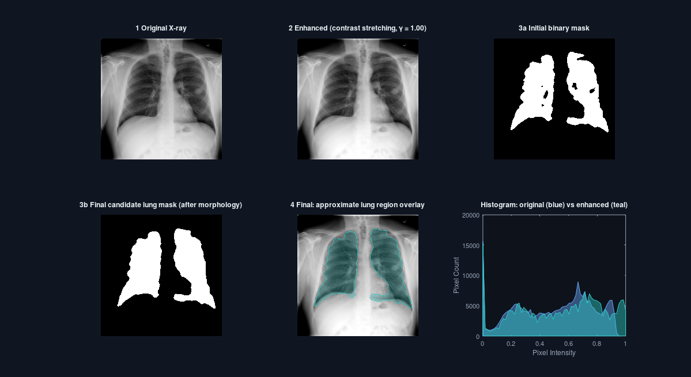
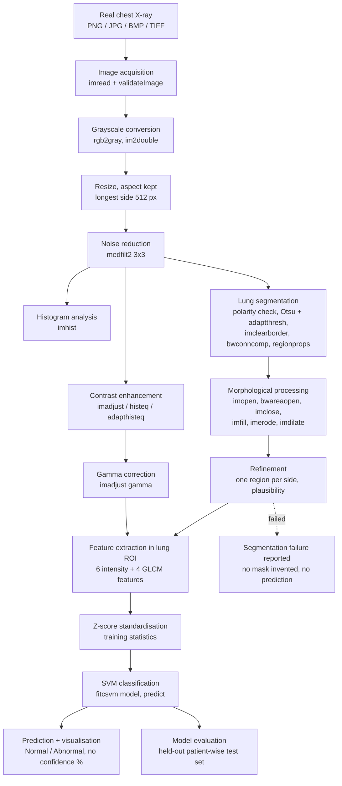
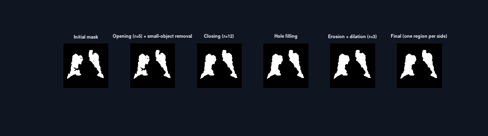

# Chest X-Ray Abnormality Detection using MATLAB

**Classical Medical Image Processing and Machine Learning**

> **Medical disclaimer** — This project is intended for educational and research
> purposes only. Its predictions are not a medical diagnosis and must not be used
> for clinical decision-making.

A MATLAB desktop application that processes real chest X-rays from the
**NIH ChestX-ray14** dataset with classical image processing (noise reduction,
contrast enhancement, gamma correction, lung segmentation, morphology,
intensity and GLCM texture features) and classifies each image as
**Normal** or **Abnormal** with a **Support Vector Machine**. No deep learning,
no pretrained networks, no external AI services.


*Real output of this project's processing code on NIH image `00027426_000.png`
(dataset label: No Finding). Generated with GNU Octave and the test shims in
`tests/octave_compat/`; MATLAB output differs slightly. The teal overlay is the
approximate segmented lung region, not a lesion map.*

---

## Contents

1. [Project overview](#1-project-overview)
2. [Objectives](#2-objectives)
3. [Technologies used](#3-technologies-used)
4. [System architecture](#4-system-architecture)
5. [Processing workflow](#5-processing-workflow)
6. [Dataset source and setup](#6-dataset-source-and-setup)
7. [Required MATLAB toolboxes](#7-required-matlab-toolboxes)
8. [Installation / setup](#8-installation--setup)
9. [How to launch the application](#9-how-to-launch-the-application)
10. [How to configure the dataset](#10-how-to-configure-the-dataset)
11. [How to train the model](#11-how-to-train-the-model)
12. [How to analyse an individual X-ray](#12-how-to-analyse-an-individual-x-ray)
13. [Morphological operations](#13-morphological-operations)
14. [Feature-extraction methodology](#14-feature-extraction-methodology)
15. [SVM classification](#15-svm-classification)
16. [Patient-wise data splitting](#16-patient-wise-data-splitting)
17. [Evaluation metrics](#17-evaluation-metrics)
18. [Troubleshooting](#18-troubleshooting)
19. [Limitations](#19-limitations)
20. [Future improvements](#20-future-improvements)
21. [Medical disclaimer](#21-medical-disclaimer)
22. [Project structure](#22-project-structure)
23. [Testing and verification status](#23-testing-and-verification-status)

---

## 1. Project overview

The application is a dark, dashboard-style MATLAB GUI (built programmatically
with `uifigure` / `uigridlayout`) with six pages:

| Page | What it does |
|---|---|
| **Dashboard** | Live status cards: dataset images processed, model training status, selected image, last evaluation metrics. They show "Not available", "Model not trained" or "Evaluation pending" until those things actually exist. The page also lists the processing pipeline of the current image with per-step status. |
| **Image Analysis** | Four viewers: Original X-Ray, Enhanced X-Ray, Lung Segmentation Mask, Final Processed Image. Step buttons (Preprocess → Enhance Image → Segment Lung → Apply Morphology → Extract Features → Predict), **Run Full Analysis**, an enhancement-method dropdown, a gamma slider, histogram and morphology-stage inspectors, the feature table, prediction and report export. |
| **Dataset & Training** | Select the NIH folder and CSV, scan and validate, preview the patient-wise subset, set the subset options, **Start Training** with progress and cancel. |
| **Model Evaluation** | Accuracy, precision, sensitivity, specificity, F1, the number of evaluated samples, the confusion matrix and the validation-based model-selection table. Values appear only after real evaluation on the held-out test set. |
| **Project Information** | Methods, limitations, disclaimer. |
| **Settings** | Preprocessing, enhancement, GLCM and morphology parameters. |

A top bar shows the page title, the workflow status, dataset and model chips,
**Reset** and **Dashboard**. The medical disclaimer is permanently visible in
the footer.

Buttons are disabled until their prerequisites exist (the rules live in one
function, `pipeline/analysisPrerequisites.m`). Their tooltips say what is missing.

## 2. Objectives

* Apply the core techniques of a medical image processing course to real chest
  radiographs, and make every intermediate result visible.
* Build a scientifically defensible classical ML pipeline:
  * dataset-derived labels with explicit handling of invalid labels;
  * patient-wise train / validation / test splits;
  * hyper-parameter selection on validation data only;
  * a single, final evaluation on a held-out test set.
* Be honest: no fabricated metrics, no fake confidence values, no lesion
  "detection" claims, and clear failure states.

## 3. Technologies used

| Component | Used for |
|---|---|
| MATLAB R2021a+ | language, runtime, `uifigure` dashboard |
| Image Processing Toolbox | preprocessing, enhancement, segmentation, morphology, GLCM |
| Statistics and Machine Learning Toolbox | `fitcsvm`, `predict`, `confusionmat`, `confusionchart` |
| GNU Octave 8 + image / statistics 1.7 | *optional*, automated tests only (no GUI) |

## 4. System architecture

The code is layered. The GUI never processes images itself; it calls the same
functions that the command-line workflow uses.

```text
app/              UI only: page builders + AppController (state, callbacks, rendering)
pipeline/         single-image step engine shared by GUI, training and prediction
preprocessing/    grayscale, resize, noise reduction, enhancement, gamma, histograms
segmentation/     lung segmentation, morphological processing, mask refinement
features/         intensity + GLCM features (fixed order)
machine_learning/ NIH metadata, image index, subset + patient split, SVM, evaluation
utils/            configuration, validation, logging, export, dependency check
tests/            automated tests (MATLAB and Octave)
```

`pipeline/runAnalysisStep.m` runs one stage of the pipeline. The GUI step buttons,
**Run Full Analysis**, dataset feature extraction (`buildFeatureMatrix` →
`runImagePipeline`) and prediction (`predictImage`) all call it. Training images
and new images are therefore processed by exactly the same code, and the trained
model stores the configuration it was trained with.

## 5. Processing workflow



| Stage | Function | What happens and why |
|---|---|---|
| Acquisition | `validateImage` | Checks existence, extension, decodability, layout and size. Indexed images become RGB, alpha is dropped, and the original is kept. |
| Grayscale | `preprocessImage` | `rgb2gray` for RGB, then `im2double`, so uint8, uint16 and double inputs share one numeric representation in [0, 1]. |
| Resize | `preprocessImage` | The longest side becomes 512 px and the aspect ratio is kept, so pixel-based parameters mean the same thing for every image. |
| Noise reduction | `reduceNoise` | A 3×3 median filter removes impulse noise (dead/hot pixels, artefacts) while keeping edges. Gaussian or none can be selected in Settings. Small windows keep the lung texture that the GLCM measures. |
| Enhancement | `enhanceImage` | Exactly one method: contrast stretching (`stretchlim` + `imadjust`, default), histogram equalization (`histeq`) or CLAHE (`adapthisteq`). |
| Gamma | `applyGammaCorrection` | out = in^γ via `imadjust`; default γ = 1.0, adjustable 0.3–3.0. |
| Histograms | `computeHistogramData` | 64-bin `imhist` of the original and enhanced image (x = pixel intensity, y = pixel count). |
| Segmentation | `segmentLungs` | See the next paragraph. |
| Morphology | `morphologicalProcessing` | See [section 13](#13-morphological-operations). |
| Refinement | `refineLungMask` | Keeps the largest region on each image half and checks the area. Status is `ok`, `partial` (flagged) or `failed`. |
| Features | `extractFeatures` | 10 features inside the final lung mask. See [section 14](#14-feature-extraction-methodology). |

**Lung segmentation.** No single global threshold works for every radiograph,
so `segmentLungs` uses these steps:

1. Contrast stretching.
2. A polarity check: the mediastinum should be brighter than the lateral lung
   bands; inverted images are complemented.
3. Gaussian smoothing (σ = 2).
4. An Otsu threshold (`graythresh`) computed on the central image region.
5. Adaptive thresholds (`adaptthresh`) at four sensitivities, each with and
   without the Otsu gate.
6. Removal of air outside the body (`imclearborder` on an eroded copy).
7. Connected components (`bwconncomp`, `regionprops`) filtered by area and
   centroid position, keeping one component per side.
8. A plausibility score (two regions, total area 8–45 %, left/right symmetry)
   that picks the best candidate.

If nothing plausible is found, the status is **failed** and the mask stays
empty. A substitute mask is never generated. Segmentation uses the denoised
image (not the display enhancement), so changing the enhancement method in the
GUI does not change the mask.

Morphology on a real NIH image (`00000001_000.png`, dataset label Cardiomegaly):



## 6. Dataset source and setup

* **Dataset**: NIH ChestX-ray14 (Wang et al., CVPR 2017). It has 112,120
  frontal chest X-rays of 30,805 patients, with 14 finding labels mined from
  radiology reports.
* **Official source**: <https://nihcc.app.box.com/v/ChestXray-NIHCC>
* **Metadata**: `Data_Entry_2017_v2020.csv`. Columns used: `Image Index`,
  `Finding Labels`, `Patient ID`, `View Position`, `Follow-up #`. Columns are
  found by header name.
* **Binary labels** (dataset-derived reference labels):
  * `No Finding` → **Normal**
  * any of the 14 findings (Atelectasis, Cardiomegaly, Consolidation, Edema,
    Effusion, Emphysema, Fibrosis, Hernia, Infiltration, Mass, Nodule,
    Pleural_Thickening, Pneumonia, Pneumothorax) → **Abnormal**
  * empty labels, unknown label text, `No Finding` combined with a finding,
    a missing patient ID or a duplicate file name → the row is **excluded and
    reported**. It is never treated as Normal.
* **Label quality**: the labels were extracted automatically from radiology
  reports with NLP. They contain errors and uncertainty; they are reference
  labels, not clinical ground truth.

The dataset is **not** included and is never downloaded automatically. See
[`dataset/PLACE_DATASET_HERE.md`](dataset/PLACE_DATASET_HERE.md) for
step-by-step download and folder instructions. One archive (`images_001`,
4,999 images of 1,335 patients) is enough for the default 1,000-image
experiment: on the real metadata, the default settings select 320/320 train,
80/80 validation and 100/100 test images from 1,000 distinct patients.

`tests/data/nih_samples/` contains two real NIH images (one Normal, one
Abnormal) for trying the single-image workflow. Two images cannot be used to
train or evaluate anything.

## 7. Required MATLAB toolboxes

* **Image Processing Toolbox**
* **Statistics and Machine Learning Toolbox**

`utils/checkDependencies.m` checks both licences and every function the code
uses. The dashboard shows a clear message naming anything missing. Details are
in [`requirements.md`](requirements.md).

## 8. Installation / setup

1. Install MATLAB **R2021a or newer** with the two toolboxes above.
2. Clone or download this repository. No absolute paths are hard-coded.
3. Download the dataset ([section 6](#6-dataset-source-and-setup)). It can live
   anywhere.

`main.m` adds all project folders to the path. To use functions from the
command line, run `setupProject` once per MATLAB session.

## 9. How to launch the application

```matlab
cd path/to/MIP_PROJECT
main
```

If `models/trainedModel.mat` exists it is loaded automatically, and the image
analysis panels adopt the processing settings the model was trained with.

## 10. How to configure the dataset

1. Open **Dataset & Training**.
2. **Browse** → select the dataset folder (the one containing `images_001`, …).
   `Data_Entry_2017_v2020.csv` is detected automatically when it is in that
   folder; otherwise use the second **Browse**.
3. **Scan & Validate Dataset**. This reads and validates the metadata, indexes
   every image under the folder (recursively, so the archive layout can stay as
   extracted) and shows:
   * metadata rows, labelled images found on disk, Normal / Abnormal counts and
     patients;
   * the planned patient-wise subset per split (Normal, Abnormal, patients,
     requested counts);
   * validation messages: excluded rows and their reasons, images not found,
     duplicate file names, whether the official split lists were found, and
     every shortfall between the requested and achievable subset size.

Subset options: requested size (default 1,000), balanced or natural classes,
view positions (PA only by default, or PA + AP), maximum images per patient
(default 1), test and validation fractions, random seed, SVM kernels to
compare, and whether to re-use the feature cache.

## 11. How to train the model

**In the dashboard**: Dataset & Training → **Start Training**. A progress
dialog shows each stage (metadata, indexing, feature extraction per image,
model selection, evaluation) and can be cancelled. When training finishes, the
Model Evaluation page opens with the real test-set results.

**From the command line** (same code):

```matlab
setupProject();
r = runTrainingWorkflow('D:\data\NIH-ChestXray14');          % defaults from appConfig
cfg = appConfig(); cfg.dataset.subsetSize = 300;               % smaller development run
r = runTrainingWorkflow('D:\data\NIH-ChestXray14', 'Config', cfg);
r.evaluation.metrics                                           % test-set metrics
```

Outputs:

* `models/trainedModel.mat` — classifier, kernel and hyper-parameters, feature
  names and order, standardisation parameters, class labels, the full pipeline
  configuration, the training configuration, dataset metadata (folder, split
  source, counts, seed) and the test evaluation.
* `results/evaluation_<timestamp>/` — `metrics.txt`, `metrics.csv`,
  `confusion_matrix.csv`, `test_predictions.csv`, `dataset_split.csv`,
  `skipped_images.csv`.
* `cache/featureCache.mat` — features already computed with an identical
  pipeline configuration, re-used by later runs.

Images whose lung segmentation fails are **skipped and listed** in
`skipped_images.csv`, because lung-ROI features are not defined for them.

Rough runtime: about 0.3–0.6 s per image for feature extraction, so 1,000
images take about 5–10 minutes. SVM model selection takes seconds to a minute.

## 12. How to analyse an individual X-ray

1. **Image Analysis** → **Upload X-Ray** (PNG, JPG, JPEG, BMP, TIFF; grayscale
   or RGB). The original image and its size, format and colour type are shown.
2. Either step through **Preprocess → Enhance Image → Segment Lung → Apply
   Morphology → Extract Features → Predict**, or click **Run Full Analysis**.
3. Choose the enhancement method and gamma at any time. The enhanced image and
   histogram update; the lung mask is kept; features and prediction are cleared
   and must be recomputed.
4. **Inspect**: *Histograms* (original vs enhanced) or *Morphology stages*
   (initial mask, after morphology, final mask, plus pixel counts after every
   operation).
5. **Prediction** shows the predicted class, the dataset label (when NIH
   metadata has been scanned and the file name is in it), the uncalibrated SVM
   decision value and the model description.
6. **Export Report** saves a TXT or CSV report with: project name, date and
   time, file name, preprocessing method, gamma, segmentation status, feature
   ROI, all feature values, model status, prediction, dataset label and the
   disclaimer. No patient information is included.

Without a trained model, all processing and feature extraction work, but
**Predict** is disabled with an explanation. If the current enhancement or
processing settings differ from the model's training configuration, the image
is re-processed with the model's configuration for the prediction, and the
result panel says so.

If segmentation fails, features can still be computed on the **whole image**
for exploration. They are clearly marked as such and are never classified,
because the model was trained on lung-ROI features.

**Command line**:

```matlab
r = predictImage('tests/data/nih_samples/00027426_000.png');   % uses models/trainedModel.mat
r.label, r.score, r.features
```

## 13. Morphological operations

All structuring elements are exact disks `strel('disk', r, 0)`. Radii refer to
the 512 px processing resolution and can be changed in Settings.

| Order | Operation | MATLAB | Purpose |
|---|---|---|---|
| 1 | **Opening** (erosion then dilation), r = 5 | `imopen` | Removes small noise blobs and thin spurs (e.g. along the trachea) without shrinking large regions. |
| 2 | Small-object removal (< 0.5 % of the image) | `bwareaopen` | Deletes isolated fragments. |
| 3 | **Closing** (dilation then erosion), r = 12 | `imclose` | Bridges small gaps, reconnects broken lung pieces, smooths concave notches. |
| 4 | **Hole filling** | `imfill(…, 'holes')` | Fills enclosed holes caused by vessels, ribs or dense regions, so the ROI covers the whole lung field. |
| 5 | **Erosion**, r = 3 | `imerode` | Peels a thin boundary layer and removes 1-pixel protrusions. |
| 6 | **Dilation**, r = 3 | `imdilate` | Grows the region back; erosion followed by dilation smooths the contour. |
| 7 | Refinement | `bwconncomp`, `regionprops` | Keeps the largest region on each side (approximate right and left lung) and checks plausibility. |

Empty input masks are handled safely, and an empty result is reported as a
failure. These operations only make the mask more consistent. **They do not
detect disease and do not identify pathological regions.**

## 14. Feature-extraction methodology

`features/extractFeatures.m` takes a grayscale image and an optional ROI mask.
It returns a 1×10 numeric vector and a table (Feature, Group, Value), always in
this order:

| # | Feature | Group | Definition |
|---|---|---|---|
| 1 | Mean | intensity | average ROI intensity |
| 2 | Std | intensity | standard deviation (N−1) |
| 3 | Variance | intensity | Std² |
| 4 | Min | intensity | darkest ROI pixel |
| 5 | Max | intensity | brightest ROI pixel |
| 6 | Entropy | intensity | Shannon entropy of the 256-bin ROI histogram (`entropy`) |
| 7 | Contrast | GLCM | Σ\|i−j\|² p(i,j) — local intensity variation |
| 8 | Correlation | GLCM | linear dependency of neighbouring grey levels |
| 9 | Energy | GLCM | Σ p(i,j)² — uniformity |
| 10 | Homogeneity | GLCM | Σ p(i,j)/(1+\|i−j\|) — closeness to the diagonal |

* **Input image**: the enhanced, gamma-corrected image (default: contrast
  stretching, γ = 1). Contrast stretching keeps the intensity ordering, so
  density information survives. The configuration is stored with the model.
* **ROI**: the final lung mask. Pixels outside it are set to NaN, and
  `graycomatrix` ignores every pixel pair containing a NaN.
* **GLCM parameters**: 32 grey levels; fixed `GrayLimits` [0 1], so the same
  intensity always maps to the same level; offsets `[0 1; -1 1; -1 0; -1 -1]`
  (0°, 45°, 90°, 135° at distance 1); symmetric. Each property is averaged
  over the four directions.
* **Error handling**: empty or too-small ROIs (< 500 px), mismatched or
  non-binary masks and NaN/Inf pixels raise explicit errors. A constant region
  makes the GLCM correlation undefined, and this is **reported**
  (`CXR:nonFiniteFeature`), never replaced by an arbitrary value.
* No rule such as "brighter means diseased" is hard-coded anywhere; the SVM
  learns from labelled data.

## 15. SVM classification

`machine_learning/trainSVM.m`:

1. **Validation of inputs**: matching sizes, finite values, known labels, both
   classes present, at least 10 training and 3 validation samples per class.
   Otherwise training stops with an explanation (`CXR:singleClass`,
   `CXR:insufficientData`, …).
2. **Standardisation**: z-score with the mean and standard deviation of the
   training data (`standardizeFeatures`). The same parameters are stored and
   applied to every new image. Constant features are flagged.
3. **Class imbalance**: `'Prior','uniform'`. `fitcsvm` normalises the
   observation weights of each class to its prior, so both classes carry equal
   total weight. (Inverse-frequency `'Weights'` alone would be undone by
   `fitcsvm`'s renormalisation to the empirical prior.) The default subset is
   balanced anyway.
4. **Explicit kernel and hyper-parameter selection on the validation set**:
   * linear kernel with BoxConstraint ∈ {0.1, 1, 10, 100};
   * RBF kernel with BoxConstraint ∈ {0.1, 1, 10, 100} × KernelScale ∈
     {0.5, 1, 2, 4, 8}·√10.

   Each candidate is trained on the training split and scored by **balanced
   accuracy on the validation split**. Ties go to the simpler model. The test
   set is never used here.
5. **Final model**: refitted with the chosen hyper-parameters on training +
   validation data; standardisation is recomputed on that data.

Predictions show the **class only**. SVM decision values are uncalibrated
margins, not probabilities, so no confidence percentage is displayed. The raw
decision value is shown and labelled as such.

## 16. Patient-wise data splitting

The NIH dataset contains several images per patient (follow-ups). If images of
one patient were in both the training and the test set, the test score would
be optimistic. Therefore:

* `splitByPatient` assigns **patients**, not images, to train / validation /
  test. All images of a patient go to the same subset, and the overlap is
  verified (`patientOverlap` must be 0, otherwise the run stops).
* If `train_val_list.txt` and `test_list.txt` (official NIH lists, patient-wise)
  are present, they define the test set; validation patients are drawn from
  the training patients.
* Otherwise a **reproducible random patient-wise split** is made (seed 42 by
  default; test 20 % and validation 20 % of the remaining patients).
* Sampling happens **inside** each split, so the subset can never break the
  patient separation. At most `maxImagesPerPatient` images per patient (default
  1) reduces redundancy.
* The requested subset size is a target. The actual per-split class counts are
  reported, together with every shortfall.

## 17. Evaluation metrics

The **positive class is Abnormal**. Metrics are computed once, on the held-out
patient-wise test set, by `machine_learning/evaluateModel.m` (`confusionmat`
with an explicit class order):

| Metric | Formula | Meaning |
|---|---|---|
| Accuracy | (TP+TN)/(TP+TN+FP+FN) | fraction of correct predictions |
| Precision | TP/(TP+FP) | of the images predicted Abnormal, the fraction labelled Abnormal |
| Sensitivity (recall) | TP/(TP+FN) | fraction of Abnormal-labelled images found |
| Specificity | TN/(TN+FP) | fraction of Normal-labelled images recognised |
| F1-score | 2·P·R/(P+R) | balance of precision and recall |
| Balanced accuracy | (Sens+Spec)/2 | used for model selection on validation data |

Zero denominators give **undefined** values. These are listed explicitly and
never shown as 0 % or 100 %. The evaluation page also shows the number of
evaluated samples and their class distribution.

**No results are reported in this repository**, because no model has been
trained on NIH ChestX-ray14 here (see
[section 23](#23-testing-and-verification-status)). Expect modest
performance: ten hand-crafted features are a weak representation of 14
heterogeneous findings. A good accuracy value alone would not establish
clinical usefulness either.

## 18. Troubleshooting

| Symptom | Cause / fix |
|---|---|
| "Missing dependencies: …" at start-up | Install or license the Image Processing Toolbox and the Statistics and Machine Learning Toolbox; use MATLAB R2021a+. |
| "Metadata CSV not found" | Put `Data_Entry_2017_v2020.csv` in the dataset folder or select it with the second Browse button. |
| "0 labelled images found on disk" | The archives are not extracted under the selected folder, or a different folder was selected. Indexing searches up to 6 folder levels deep. |
| "Requested … but only … could be selected" | Not enough eligible images or patients for that split and class. Add archives, allow PA + AP, allow more images per patient, or request a smaller subset. |
| `CXR:singleClass` / `CXR:insufficientData` | A split has no (or too few) images of one class; adjust the subset options. |
| "Lung segmentation failed" | Unusual exposure, non-frontal view, heavy opacities or external objects. The image is skipped in training; in the GUI only whole-image exploratory features are possible. |
| Predict is disabled | No trained model, features not extracted yet, or the features are whole-image (segmentation failed). The tooltip says which. |
| "differ from the model's training configuration" | Your Settings or enhancement choice differs from the model's. Predictions automatically use the model's configuration. |
| Saved model cannot be loaded | It was trained with a different feature definition (`CXR:invalidModel`). Re-train. |
| Developer details | Every error is logged with its identifier and location in `logs/app.log`. |

## 19. Limitations

* **Labels**: NIH labels are NLP-mined from reports and are known to contain
  errors. They are reference labels, not ground truth.
* **Features**: ten intensity and texture statistics of the whole lung region
  cannot describe small or localised findings (nodules, pneumothorax, …).
  Performance is expected to be limited.
* **Segmentation**: heuristic and threshold-based; **not validated** against
  annotated lung masks. It can under-segment lungs (e.g. behind an enlarged
  heart or at the apices), and fails on unusual images.
* **Classification is not localisation**: the lung overlay shows the
  approximate segmented lung region, **not** where an abnormality is. No
  heatmaps or lesion boxes are produced.
* **Confounders**: devices, hospital processing and patient position can
  correlate with labels. PA-only selection reduces one such shortcut (AP views
  are more common in sick patients), but confounding is not controlled.
* **Binary task**: "Abnormal" merges 14 very different findings.
* **Not clinically validated**: a "Normal" prediction does not mean the patient
  is healthy, and an "Abnormal" prediction does not mean a disease is present.

## 20. Future improvements

* Validate lung segmentation against public lung masks (e.g. JSRT, Montgomery
  County datasets) and report Dice scores.
* Add shape features of the lung mask and regional (upper / lower zone)
  texture features; run feature-selection experiments on validation data only.
* Patient-grouped k-fold cross-validation for more stable model selection.
* Probability calibration (Platt scaling on held-out data) with a reliability
  diagram, before any probability is displayed.
* Per-finding (multi-label) experiments and analysis of failure cases.

## 21. Medical disclaimer

**This project is intended for educational and research purposes only. Its
predictions are not a medical diagnosis and must not be used for clinical
decision-making.** The system is not clinically validated. It must not be used
to rule disease in or out, and highlighted lung regions are not confirmed
lesions.

## 22. Project structure

```text
MIP_PROJECT/
├── main.m                      start the dashboard
├── setupProject.m              add project folders to the path
├── README.md, requirements.md
├── app/                        GUI (no image processing inside)
│   ├── launchApp.m             window, sidebar, top bar, footer, pages
│   ├── AppController.m         state + all callbacks + rendering
│   ├── buildSidebar.m, buildTopBar.m
│   ├── buildDashboard.m, buildAnalysisPage.m, buildTrainingPage.m,
│   ├── buildEvaluationPage.m, buildAboutPage.m, buildSettingsPage.m
│   ├── uiTheme.m, uiCard.m, uiButton.m, uiText.m, uiPill.m, uiImageAxes.m
│   └── showImage.m, showEmptyState.m, plotHistograms.m, plotConfusion.m
├── pipeline/                   step engine shared by GUI, training, prediction
│   ├── createAnalysis.m, runAnalysisStep.m, runImagePipeline.m
│   ├── analysisPrerequisites.m, clearAnalysisFrom.m, pipelineConfigsMatch.m
├── preprocessing/              preprocessImage, reduceNoise, enhanceImage,
│                               applyGammaCorrection, computeHistogramData
├── segmentation/               segmentLungs, morphologicalProcessing, refineLungMask
├── features/                   extractFeatures, extractIntensityFeatures, extractGLCMFeatures
├── machine_learning/
│   ├── loadDatasetMetadata.m, indexDatasetImages.m, loadOfficialSplit.m
│   ├── prepareDataset.m, splitByPatient.m, buildFeatureMatrix.m
│   ├── trainSVM.m, standardizeFeatures.m, svmPredict.m, classifyFeatures.m
│   ├── predictImage.m, evaluateModel.m, runTrainingWorkflow.m
│   └── loadTrainedModel.m, validateModel.m, defaultModelFile.m
├── utils/                      appConfig, checkDependencies, validateImage,
│                               exportReport, exportEvaluation, saveConfusionFigure,
│                               createMaskOverlay, logMessage, seededPermutation, ...
├── models/                     trainedModel.mat (created by training)
├── dataset/PLACE_DATASET_HERE.md
├── results/                    evaluation_<timestamp>/ (created by training)
├── docs/images/                figures used in this README
├── tests/
│   ├── runAllTests.m           test runner (MATLAB and Octave)
│   ├── testPreprocessing.m, testSegmentation.m, testFeatureExtraction.m,
│   ├── testMetrics.m, testDataset.m, testTraining.m, testGui.m
│   ├── helpers/                runCase, expectError, synthetic phantoms
│   ├── data/nih_samples/       two real NIH images (fixtures)
│   ├── octave_compat/          Octave-only shims for missing IPT functions
│   └── ui_mock/                Octave-only headless UI stand-ins
└── legacy/                     previous iteration, not on the path (see legacy/README.md)
```

## 23. Testing and verification status

Run all tests:

```matlab
cd tests
runAllTests                 % everything (about 2 minutes)
runAllTests('quick')        % skip the end-to-end training workflow
runAllTests('nihCsv', 'D:\data\NIH\Data_Entry_2017_v2020.csv')   % + real CSV checks
```

The 105 tests cover:

* **Preprocessing**: RGB→grayscale, grayscale, uint16 and double inputs,
  aspect ratio, median/Gaussian/none filtering, all enhancement methods, gamma,
  histograms, and invalid inputs (nothing selected, missing, corrupted,
  unsupported, too small, NaN).
* **Segmentation**: synthetic phantoms (Dice > 0.8), inverted polarity,
  segmentation failure, each morphological operation, empty masks, refinement,
  step order and invalidation, and the real NIH samples.
* **Feature extraction**: dimensions, name/order consistency, ROI-only
  computation, value ranges, and invalid mask / empty ROI / constant / NaN
  images.
* **Metrics**: hand-computed reference values and undefined (zero-denominator)
  cases.
* **Dataset**: missing dataset and CSV, label mapping incl. conflicting, empty,
  unknown, duplicate and missing-patient rows, nested-folder indexing, official
  lists, patient-split integrity and reproducibility, subset balance, and
  shortfall reporting.
* **SVM and prediction**: training, standardisation re-use, validation-based
  selection, rejected inputs, model save/load, single-image prediction with the
  model configuration, report and evaluation export, an end-to-end workflow,
  and cancellation.
* **GUI**: navigation, enable/disable rules, all step buttons, enhancement
  controls, inspectors, full analysis, report export, error and
  segmentation-failure paths, dataset scan, training, prediction, settings,
  reset and a layout check.

Synthetic arrays and phantom images are used **only** for software tests; no
test result is a medical performance figure.

**What has been verified, and how.** These checks were run in a Linux container
without MATLAB, using GNU Octave 8.4 with the image 2.14 and statistics 1.7.0
packages:

* **104 tests passed, 0 failed.** One test was skipped: re-loading a saved
  classifier and predicting with it, because Octave converts saved classifier
  objects to structs. That test needs MATLAB.
* Under Octave the GUI tests drive the real page builders and controller, but
  with headless stand-in components (`tests/ui_mock`).
* The real `Data_Entry_2017_v2020.csv` was parsed: 112,120 rows, 60,361
  No Finding, 30,805 patients, which matches the published dataset statistics.
* Segmentation was checked visually on the 2 NIH samples and 5 further real
  radiographs.

**Not yet verified**:

* the dashboard's appearance and its MATLAB graphics calls;
* the reloaded-model test (MATLAB only);
* a training run on the real NIH images (they were not available in the
  development environment).

Run `runAllTests` in MATLAB and train on the downloaded dataset to complete
the verification.
